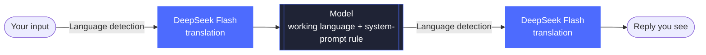

<div align="center">


# dsh-language-bridge

**Give each model a working language** — you write in your own language, the model answers in its working language, and DeepSeek Flash translates in between.


[中文](README.md) · **English** · [日本語](README.ja.md) · [Español](README.es.md) · [Français](README.fr.md) · [Deutsch](README.de.md) · [Русский](README.ru.md) · [Português](README.pt.md)

[Features](#features) · [Installation](#installation) · [Settings](#settings) · [How it works](#how-it-works) · [Language detection](#language-detection) · [Known limitations](#known-limitations)

</div>

<br>

A community plugin for [DeepSeek Harness](https://github.com/deepseek-ai/deepseek-harness). You type in your own language, DeepSeek Flash translates it into the model's working language before it is sent, and the model's reply is translated back into your language and shown in place. Any language and any model can be configured — for example, you write in Spanish, Claude and Gemini are set to English, and some Chinese model is set to `zh-CN`.

<p align="center">
  
</p>

<p align="center"><sub>Your language is <code>auto</code> (following the Chinese interface) and Claude's working language is English. Once the reply finishes it is swapped for Chinese; "View original" (查看原文) shows the model's English reply, and "View sent text" (查看发送内容) shows the English that was actually sent to the model. The demo was recorded with the Chinese interface, so the captions and buttons appear in Chinese.</sub></p>

## Features

- 🧭 **Model → language rules** — an ordered list; model ids are matched by regex (case-insensitive) and the first match wins. Models that match nothing are left untouched.
- 🌐 **Your language** — any BCP 47 code (`es`, `ja`, `zh-CN`…), or `auto` to follow the interface language.
- ➡️ **Input translation** — translates what you wrote into the working language before sending. Code blocks, inline code, links and `@paths` are kept as is.
- ⬅️ **Reply translation** — after each turn the reply is swapped for its translation, with "View original / View translation" toggling in place. Thinking content is not translated.
- 📌 **Stay in the working language** — adds a rule to the system prompt of bridged models asking them to think and answer in the working language even when tool output arrives in another language.
- ⚠️ **Failures are visible** — if translation fails, the original text is sent as usual so the turn is not lost, and a warning is shown under the message.
- 🆓 **Same language, zero cost** — when your language and the model's working language are the same (e.g. `en-GB` and `en`), nothing is translated, no system prompt is added and nothing is charged.

<p align="center">
  
  <br>
  <sub>When translation fails, the original text is sent as usual and a warning is shown under the message.</sub>
</p>

## Installation

**Requirements:** DeepSeek Harness (tested with 0.2.1-rc.5 on macOS), with a DeepSeek API key or a signed-in DeepSeek account configured in it; DeepSeek Flash does the translating.

On the Harness Plugins page, click **Add plugin** and enter the address below. Restart DeepSeek Harness once it has installed.

```
https://github.com/tonyzdev/dsh-language-bridge
```

<details>
<summary><b>Installing or removing from the command line</b></summary>

<br>

Fully quit DeepSeek Harness first, then run (this is the `dsh` path on macOS):

```sh
DSH="/Applications/DeepSeek Harness.app/Contents/Resources/runtime/cli/bin/dsh"
"$DSH" plugin --profile desktop add github:tonyzdev/dsh-language-bridge
```

To work on the code, clone it and install it as a link, so your edits apply to that copy directly:

```sh
git clone https://github.com/tonyzdev/dsh-language-bridge ~/.dsh/local-plugins/dsh-language-bridge
"$DSH" plugin --profile desktop add link:$HOME/.dsh/local-plugins/dsh-language-bridge
```

To remove it, uninstall it on the Plugins page, or quit Harness and run:

```sh
"$DSH" plugin --profile desktop remove dsh-language-bridge
```

</details>

## Settings

Open Plugins → Language Bridge. Changes take effect from the next step after saving; no restart needed.

<p align="center">
  
</p>

| Field | Description |
| --- | --- |
| **Your language** | With `auto`, the browser reports the interface language to the Host, which stores it; an interface language of `zh` is treated as `zh-CN`. |
| **Model rules** | Rules can be added, removed and moved up or down. Regexes and language codes are validated live in the form; you cannot save while there are errors. |
| **Test a model id** | Enter a model id to see which rule it matches and whether translation would apply. |

**Default rules**

| Model id regex | Working language |
| --- | :---: |
| `claude` | `en` |
| `gemini` | `en` |
| `(^\|[^a-z0-9])(chat)?gpt($\|[^a-z])` | `en` |

The GPT rule has boundaries: it matches `gpt-5`, `openai/gpt-4o`, `chatgpt-4o` and `gpt-oss` without accidentally matching ids like `egpt-1` or `mygpt`.

> [!TIP]
> Settings are stored in `$DSH_HOME/storages/language-bridge.json` (`DSH_HOME` defaults to `~/.dsh`), which takes precedence over `cordis.patch.yml`. You can also set initial values in `cordis.patch.yml` with `rules` and `userLanguage`, and adjust behaviour with `provider` (`auto` / `deepseek-official` / `deepseek-account`), `translateInput` and `translateOutput`.

## How it works



<p align="center"><sub>When language detection finds the text is already in the target language, translation is skipped and the text is sent or shown as is.</sub></p>

| File | Where | Role |
| --- | :---: | --- |
| `index.js` | Host | Translates input in `agent/pre-step`; system-prompt section; `/api/language-bridge/*` endpoints (reply translation, reading/writing settings, reporting the interface language; owner only) |
| `rules.js` | Shared | Rule matching, language-code validation, settings merging, system-prompt text (pure functions) |
| `detect.js` | Shared | Decides whether a text still needs translating (pure functions) |
| `protect.js` | Shared | Protects code and links with placeholders, translates in chunks |
| `client.js` | Browser | In-place replacement and toggling of replies, "View sent text / View original" and the failure warning on user messages, the settings page |
| `cordis.patch.yml` | Patch | Inserts the translator service entry and this plugin's entry |

<details>
<summary><b>Implementation details</b></summary>

<br>

- Translation goes through dsh's bundled `@deepseek-ai/dsh-experimental-translator`, preferring `deepseek-official` (API key) and falling back to `deepseek-account`. Paid results are stored in the session, so reopening it is not charged again.
- Originals are stored in the message's `source.languageBridge`; the model never sees them, they are only used for display.
- Only messages you wrote are translated; system-injected context and sub-agent messages are not.
- If the translation model drops a placeholder, the plugin falls back to translating only the text between placeholders, so code and links are never lost.
- The settings page uses the `plugins.bundle.config` slot of the plugin detail page rather than the Harness's built-in config form: the latter requires `schemastery`, which a local plugin installed via `link:` cannot resolve.

</details>

## Language detection

`needsTranslation(text, { target, source })` decides whether a piece of text still needs translating into `target`, checking in order:

1. **Strip non-prose** — protected fragments and code-like tokens (`parseConfig`, `foo_bar`, `src/app.ts`, `v2`, `--flag`, abbreviations). If no letters remain, nothing is translated.
2. **Compare scripts** — the target language's script is inferred with `Intl.Locale`, so no language table is needed. If another non-Latin script makes up a large enough share, translate. When the target is not a Latin script, Latin letters only count as foreign above 60%, because English terms mixed into Chinese, Japanese, Korean or Russian text are very common.
3. **Compare function words** — languages that share a script (such as Spanish and English) are told apart with a built-in table of function words for 17 languages. If another language clearly dominates, translate; if the target language clearly dominates, do not.
4. **Still undecided** — skip translation only when your language and the target use different scripts (a Japanese user typing `run tests`); translate in every other case.

> [!IMPORTANT]
> The trade-off is **better to over-translate than to miss a translation**. An extra translation only costs a small DeepSeek Flash fee, and if the translation comes out identical to the original it is not swapped in and no toggle button is shown; a missed translation means the model receives text in the wrong language and nobody notices.

The price:

- A Spanish user typing a short phrase with no function words, like `run tests`, triggers one extra call;
- Same-script language pairs without a function-word table (say an Indonesian user with a Swahili model) trigger one call per segment;
- Text made only of Han characters cannot be told apart as Chinese or Japanese, or Simplified or Traditional, so it is treated as needing translation.

## Upgrading from claude-zh-bridge

This plugin replaces `claude-zh-bridge`, its Chinese-only predecessor. If you never used it, skip this section.

> [!WARNING]
> Do not enable both plugins at once, or everything gets translated twice. Uninstall the old plugin on the Plugins page first, or from the command line:
>
> ```sh
> DSH="/Applications/DeepSeek Harness.app/Contents/Resources/runtime/cli/bin/dsh"
> "$DSH" plugin --profile desktop remove @local/claude-zh-bridge
> ```

Old sessions are unaffected: originals the old plugin stored in `source.claudeZhBridge` still display. The translation cache key includes the text fragment, the language and the route, and this plugin keeps the same placeholder and chunking scheme (guaranteed by unit tests), so when your language resolves to `zh-CN`, translations you already paid for in old sessions are reused directly.

## Development

```sh
node --test test/*.test.js
```

The tests cover rule ordering and matching, language detection (Latin↔Latin; CJK/Cyrillic/Arabic/Devanagari in both directions; mixed-in identifiers), protected fragments, placeholder fallback, as well as reading the legacy field and displaying the failure warning.

> [!NOTE]
> After changing `index.js` or `cordis.patch.yml`, restart DeepSeek Harness; if the UI does not change after editing `client.js`, reinstall and refresh the page.

## Known limitations

> [!CAUTION]
> **The system-prompt rule raises the odds; it cannot force anything.** Models have been seen ignoring it in testing: when translation failed and Claude received Japanese directly, it answered in Japanese; when the rule was added mid-session, Gemini Flash Lite with existing Spanish history kept answering in Spanish. A reply that is already in your language is not translated again.

- How much thinking content you can see depends on the model route and may be only a summary; when it is not visible, there is no way to confirm which language the model thinks in.
- Only code blocks, inline code, links and `@paths` are protected. Commands and quoted text without backticks get translated too, e.g. the string inside `printf "..."`. Put anything you do not want translated in backticks. A stretch of Chinese inside an English sentence is also translated.
- Session logs and the model's input contain the translation (the plugin can only rewrite a message before it is written); the original is used for display only.
- The reply is swapped for its translation only after the turn ends; while it is being generated you see the model's original text.
- With `auto`, the plugin cannot tell whether the languages match until the browser has reported the interface language; until then it relies on language detection alone.
- Every uncached segment of text is one paid DeepSeek Flash request.
- Button and warning text is available in eight languages: Chinese, English, Japanese, Spanish, French, German, Russian and Portuguese; the settings page is Chinese and English only, with English shown for other languages.
- When enabled together with the official reasoning-translation bundle (推理翻译), each mounts its own translator service and the two may conflict.
- The plugin takes over rendering of user messages, so it may need adjusting if a Harness upgrade changes the Chat structure.
