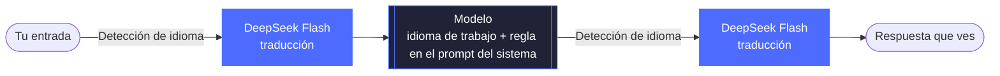

<div align="center">


# dsh-language-bridge

**Asigna a cada modelo un idioma de trabajo** — tú escribes en tu idioma, el modelo responde en su idioma de trabajo y DeepSeek Flash traduce entre ambos.


[中文](README.md) · [English](README.en.md) · [日本語](README.ja.md) · **Español** · [Français](README.fr.md) · [Deutsch](README.de.md) · [Русский](README.ru.md) · [Português](README.pt.md)

[Funciones](#funciones) · [Instalación](#instalación) · [Configuración](#configuración) · [Cómo funciona](#cómo-funciona) · [Detección de idioma](#detección-de-idioma) · [Limitaciones conocidas](#limitaciones-conocidas)

</div>

<br>

Plugin de la comunidad para [DeepSeek Harness](https://github.com/deepseek-ai/deepseek-harness). Tú escribes en tu idioma, DeepSeek Flash lo traduce al idioma de trabajo del modelo antes de enviarlo, y la respuesta del modelo se traduce de vuelta a tu idioma y se muestra en el mismo lugar. Se puede configurar cualquier idioma para cualquier modelo; por ejemplo: tú escribes en español, Claude y Gemini se configuran en inglés y algún modelo chino en `zh-CN`.

<p align="center">
  
</p>

<p align="center"><sub>Tu idioma es <code>auto</code> (sigue la interfaz en chino) y el idioma de trabajo de Claude es el inglés. Al terminar la respuesta se sustituye automáticamente por el chino; «Ver original» (查看原文) muestra la respuesta del modelo en inglés y «Ver texto enviado» (查看发送内容) muestra el texto en inglés que realmente se envió al modelo. La demo se grabó con la interfaz en chino.</sub></p>

## Funciones

- 🧭 **Reglas modelo → idioma** — lista ordenada; el id del modelo se compara con una expresión regular (sin distinguir mayúsculas de minúsculas) y se aplica la primera regla que coincide; los modelos sin coincidencia se dejan tal cual.
- 🌐 **Tu idioma** — cualquier código BCP 47 (`es`, `ja`, `zh-CN`…) o `auto` para seguir el idioma de la interfaz.
- ➡️ **Traducción de la entrada** — antes de enviar, traduce lo que escribes al idioma de trabajo. Los bloques de código, el código en línea, los enlaces y las `@ruta` se conservan intactos.
- ⬅️ **Traducción de la respuesta** — al final de cada turno sustituye la respuesta por su traducción; «Ver original / Ver traducción» alterna en el mismo lugar. El contenido de razonamiento no se traduce.
- 📌 **Mantener el idioma de trabajo** — añade una regla al prompt del sistema de los modelos puenteados para que piensen y respondan en el idioma de trabajo aunque reciban salidas de herramientas en otros idiomas.
- ⚠️ **Fallos visibles** — si la traducción falla, se envía el texto original con normalidad, no se pierde el turno y se muestra una advertencia debajo del mensaje.
- 🆓 **Sin coste con el mismo idioma** — cuando tu idioma y el idioma de trabajo del modelo coinciden (p. ej. `en-GB` y `en`), no se traduce, no se añade el prompt del sistema y no se genera ningún coste.

<p align="center">
  
  <br>
  <sub>Si la traducción falla, el texto original se envía con normalidad y se muestra una advertencia debajo del mensaje.</sub>
</p>

## Instalación

**Requisitos:** DeepSeek Harness (probado con la versión 0.2.1-rc.5 en macOS) con una clave de API de DeepSeek configurada o con la sesión iniciada en una cuenta de DeepSeek; DeepSeek Flash se encarga de la traducción.

**Lo más rápido:** pega esto en cualquier chat de DSH y deja que el agente lo instale:

```text
Install the DeepSeek Harness plugin https://github.com/tonyzdev/dsh-language-bridge into my current profile. If you have the plugin_manager tool, call install_bundle to install and enable it. Otherwise read the profile name ($DSH_PROFILE in bash, $env:DSH_PROFILE in PowerShell) and run `dsh plugin --profile <profile> add github:tonyzdev/dsh-language-bridge`, using the bundled CLI next to app.asar (runtime/cli/bin/dsh, or dsh.cmd on Windows) when the profile is desktop; ask for sandbox approval if needed. Do not edit profile files by hand.
```

En la página «Plugins» de Harness, haz clic en **Add plugin** e introduce la siguiente dirección. Cuando termine la instalación, haz clic en **Enable now**. Si no aparecen los botones del plugin, recarga la página o reinicia DeepSeek Harness.

```
https://github.com/tonyzdev/dsh-language-bridge
```

<details>
<summary><b>Instalar o eliminar desde la línea de comandos</b></summary>

<br>

Primero cierra DeepSeek Harness por completo y luego ejecuta (esta es la ruta de `dsh` en macOS):

```sh
DSH="/Applications/DeepSeek Harness.app/Contents/Resources/runtime/cli/bin/dsh"
"$DSH" plugin --profile desktop add github:tonyzdev/dsh-language-bridge
```

Para trabajar en el código, clónalo e instálalo como enlace; así tus cambios se aplican directamente a esa copia:

```sh
git clone https://github.com/tonyzdev/dsh-language-bridge ~/.dsh/local-plugins/dsh-language-bridge
"$DSH" plugin --profile desktop add link:$HOME/.dsh/local-plugins/dsh-language-bridge
```

Para eliminarlo, desinstálalo en la página «Plugins» o cierra Harness y ejecuta:

```sh
"$DSH" plugin --profile desktop remove dsh-language-bridge
```

</details>

## Configuración

Abre «Plugins → Language Bridge»; tras guardar, los cambios se aplican a partir del siguiente paso, sin reiniciar.

<p align="center">
  
</p>

| Campo | Descripción |
| --- | --- |
| **Your language** | Con `auto`, el navegador informa al Host del idioma de la interfaz y este lo guarda; el idioma de interfaz `zh` se trata como `zh-CN`. |
| **Model rules** | Se pueden añadir, eliminar y mover arriba o abajo. Las expresiones regulares y los códigos de idioma se validan al instante en el formulario; si hay errores no se puede guardar. |
| **Test a model id** | Introduce un id de modelo para ver qué regla coincide y si hace falta traducir. |

**Reglas predeterminadas**

| Regex del id de modelo | Idioma de trabajo |
| --- | :---: |
| `claude` | `en` |
| `gemini` | `en` |
| `(^\|[^a-z0-9])(chat)?gpt($\|[^a-z])` | `en` |

La regla de GPT lleva delimitadores: coincide con `gpt-5`, `openai/gpt-4o`, `chatgpt-4o` y `gpt-oss`, pero no con ids como `egpt-1` o `mygpt`.

> [!TIP]
> La configuración se guarda en `$DSH_HOME/storages/language-bridge.json` (el valor predeterminado de `DSH_HOME` es `~/.dsh`) y tiene prioridad sobre `cordis.patch.yml`. También puedes definir valores iniciales en `cordis.patch.yml` con `rules` y `userLanguage`, y ajustar el comportamiento con `provider` (`auto` / `deepseek-official` / `deepseek-account`), `translateInput` y `translateOutput`.

## Cómo funciona



<p align="center"><sub>Si la detección de idioma determina que el texto ya está en el idioma de destino, se omite la traducción y se envía o se muestra directamente.</sub></p>

| Archivo | Ubicación | Función |
| --- | :---: | --- |
| `index.js` | Host | `agent/pre-step` traduce la entrada; sección del prompt del sistema; endpoints `/api/language-bridge/*` (traducción de respuestas, lectura y escritura de la configuración, informe del idioma de la interfaz; solo para el owner) |
| `rules.js` | Compartido | Coincidencia de reglas, validación de códigos de idioma, fusión de la configuración, texto del prompt del sistema (funciones puras) |
| `detect.js` | Compartido | Decide si un texto aún necesita traducirse (función pura) |
| `protect.js` | Compartido | Protege código y enlaces con marcadores de posición y traduce por fragmentos |
| `client.js` | Navegador | Sustitución y alternancia de la respuesta en el mismo lugar, «Ver texto enviado / Ver original» y advertencia de fallo en los mensajes del usuario, página de configuración |
| `cordis.patch.yml` | Parche | Inserta la línea del servicio translator y la línea de este plugin |

<details>
<summary><b>Detalles de implementación</b></summary>

<br>

- La traducción usa el `@deepseek-ai/dsh-experimental-translator` incluido en dsh, con preferencia por `deepseek-official` (clave de API) y, en su defecto, `deepseek-account`. Los resultados pagados se guardan en la sesión; al reabrirla no se vuelve a cobrar.
- El texto original se guarda en `source.languageBridge` del mensaje; el modelo no lo ve y solo se usa para mostrarlo en la interfaz.
- Solo se traducen los mensajes que escribes tú; el contexto inyectado por el sistema y los mensajes de subagentes no se traducen.
- Si el modelo de traducción pierde los marcadores de posición, se pasa a traducir solo el texto entre marcadores, para garantizar que no se pierdan código ni enlaces.
- La página de configuración usa la ranura `plugins.bundle.config` de la página de detalles del plugin, no el formulario de configuración integrado del Harness: este último requiere `schemastery`, y los plugins locales instalados con `link:` no pueden resolver ese paquete.

</details>

## Detección de idioma

`needsTranslation(text, { target, source })` decide si un texto aún necesita traducirse a `target`, comprobando en orden:

1. **Descartar lo que no es texto** — los fragmentos protegidos y las palabras que parecen código (`parseConfig`, `foo_bar`, `src/app.ts`, `v2`, `--flag`, siglas). Si no quedan letras, no se traduce.
2. **Comparar escrituras** — deduce con `Intl.Locale` la escritura que usa el idioma de destino, sin necesidad de una tabla de idiomas. Si otra escritura no latina ocupa una proporción suficiente, se traduce. Cuando el destino no usa escritura latina, las letras latinas deben superar el 60 % para considerarse idioma extranjero, porque en chino, japonés, coreano y ruso es muy habitual intercalar términos en inglés.
3. **Comparar palabras funcionales** — los idiomas que comparten escritura (como el español y el inglés) se distinguen con las tablas integradas de palabras funcionales de 17 idiomas. Si otro idioma predomina claramente, se traduce; si predomina claramente el idioma de destino, no se traduce.
4. **Si sigue sin poder decidirse** — solo se omite la traducción cuando tu idioma y el de destino usan escrituras distintas (un usuario japonés escribe `run tests`); en los demás casos se traduce.

> [!IMPORTANT]
> El criterio es **preferir traducir de más antes que traducir de menos**. Una traducción de más solo supone un pequeño coste en DeepSeek Flash y, además, cuando la traducción coincide con el original no se sustituye ni se muestra el botón de alternar; una traducción de menos significa que el modelo recibe texto en el idioma equivocado y nadie se da cuenta.

El precio:

- un usuario hispanohablante que escribe frases cortas sin palabras funcionales, como `run tests`, provoca una llamada extra;
- en pares de idiomas con la misma escritura y sin tabla de palabras funcionales (p. ej. usuario en indonesio y modelo en suajili), cada fragmento genera una llamada;
- cuando solo hay caracteres han no se puede distinguir chino de japonés, ni simplificado de tradicional; en ese caso se trata como si necesitara traducción.

## Migración desde claude-zh-bridge

Este plugin sustituye a `claude-zh-bridge`, su predecesor, que solo admitía chino. Si nunca lo has usado, sáltate esta sección.

> [!WARNING]
> No actives los dos plugins a la vez, o todo se traducirá dos veces. Desinstala primero el plugin antiguo en la página «Plugins», o desde la línea de comandos:
>
> ```sh
> DSH="/Applications/DeepSeek Harness.app/Contents/Resources/runtime/cli/bin/dsh"
> "$DSH" plugin --profile desktop remove @local/claude-zh-bridge
> ```

Las sesiones antiguas no se ven afectadas: el texto original que el plugin antiguo guardó en `source.claudeZhBridge` se sigue mostrando. La clave de la caché de traducciones incluye el fragmento de texto, el idioma y el enrutamiento, y este plugin conserva los mismos marcadores de posición y la misma división en fragmentos (garantizado por pruebas unitarias), así que, cuando tu idioma se resuelve como `zh-CN`, las traducciones ya pagadas en las sesiones antiguas se reutilizan directamente.

## Desarrollo

```sh
node --test test/*.test.js
```

Las pruebas cubren el orden y la coincidencia de las reglas, la detección de idioma (latino↔latino; chino/japonés/coreano, cirílico, árabe y devanagari en ambos sentidos; mezcla con identificadores), los fragmentos protegidos, el respaldo de marcadores de posición, la lectura del campo antiguo y la visualización de la advertencia de fallo.

> [!NOTE]
> Tras modificar `index.js` o `cordis.patch.yml` hay que reiniciar DeepSeek Harness; si tras modificar `client.js` la interfaz no cambia, reinstala el plugin y recarga la página.

## Limitaciones conocidas

> [!CAUTION]
> **La regla del prompt del sistema solo aumenta la probabilidad; no obliga.** En las pruebas se ha visto a modelos no respetarla: cuando falló la traducción y Claude recibió japonés directamente, respondió en japonés; cuando la regla se añadió a mitad de sesión, Gemini Flash Lite, que ya tenía historial en español, siguió respondiendo en español. Si la respuesta ya está en tu idioma, no se vuelve a traducir.

- El contenido de razonamiento visible depende del enrutamiento del modelo y puede ser solo un resumen; cuando no se ve, no se puede confirmar en qué idioma piensa el modelo.
- Solo se protegen los bloques de código, el código en línea, los enlaces y las `@ruta`. Los comandos y las citas sin acentos graves también se traducen, por ejemplo las cadenas dentro de `printf "..."`. Lo que no quieras que se traduzca, ponlo entre acentos graves. Un fragmento en chino dentro de una frase en inglés también se traduce.
- En el registro de la sesión y en la entrada del modelo queda la traducción (el plugin solo puede reescribir el mensaje antes de que se guarde); el original solo se usa para mostrarlo en la interfaz.
- La respuesta se sustituye por la traducción solo al terminar el turno; durante la generación se muestra el texto original del modelo.
- Con `auto`, hasta que el navegador informa del idioma de la interfaz no se puede saber si es el mismo idioma; mientras tanto solo se usa la detección de idioma.
- Cada fragmento de texto sin caché es una petición de pago a DeepSeek Flash.
- Los botones y los textos de advertencia están disponibles en ocho idiomas: chino, inglés, japonés, español, francés, alemán, ruso y portugués; la página de configuración solo existe en chino e inglés, y en los demás idiomas se muestra en inglés.
- Si se activa junto con el bundle oficial de traducción del razonamiento («推理翻译»), cada uno monta su propia instancia del servicio translator y pueden entrar en conflicto.
- El plugin se encarga de renderizar los mensajes del usuario; si una actualización del Harness cambia la estructura del Chat, puede hacer falta ajustarlo.
