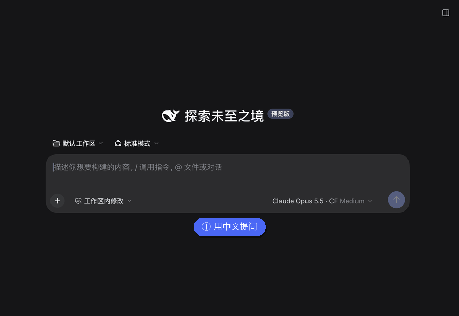
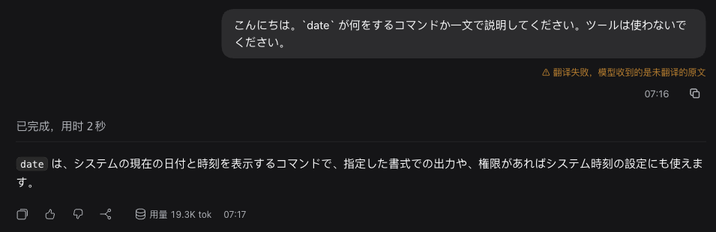
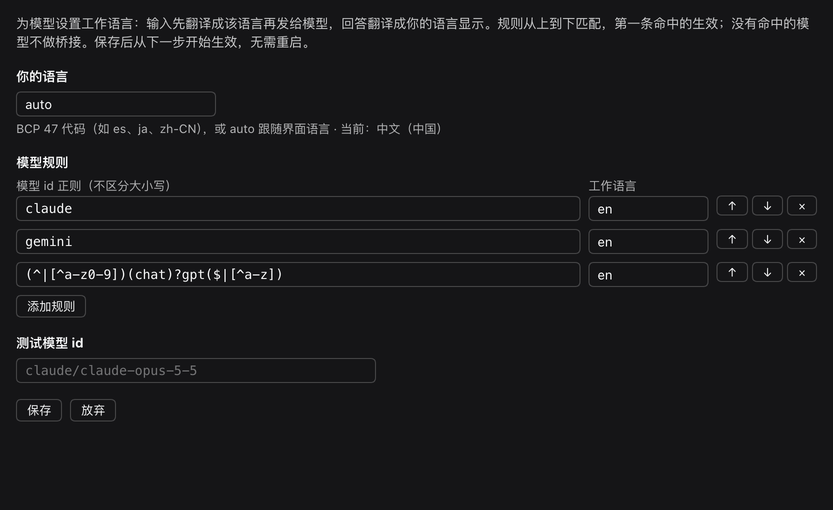

# dsh-language-bridge

[中文](README.md) | [English](README.en.md) | [日本語](README.ja.md) | [Español](README.es.md) | **Français** | [Deutsch](README.de.md) | [Русский](README.ru.md) | [Português](README.pt.md)

Plugin local pour DeepSeek Harness : **attribuez une langue de travail à chaque modèle**. Vous écrivez dans votre langue, DeepSeek Flash traduit votre texte dans la langue de travail du modèle avant l'envoi ; la réponse du modèle est ensuite retraduite dans votre langue et affichée à sa place. Toute langue et tout modèle peuvent être configurés.

Par exemple : vous utilisez l'espagnol, Claude et Gemini sont réglés sur l'anglais, et un modèle chinois sur `zh-CN`.

<p align="center">
  
</p>

Dans l'animation ci-dessus, votre langue est `auto` (elle suit l'interface en chinois) et la langue de travail de Claude est l'anglais. Une fois la réponse terminée, elle est automatiquement remplacée par sa traduction chinoise ; « Voir l'original » (查看原文) affiche la réponse anglaise du modèle, « Voir le texte envoyé » (查看发送内容) affiche le texte anglais réellement envoyé au modèle. La démonstration a été enregistrée avec l'interface en chinois.

## Fonctionnalités

- **Règles modèle → langue** : liste ordonnée ; l'id du modèle est comparé à une expression régulière (insensible à la casse) et la première règle qui correspond s'applique ; les modèles sans correspondance ne sont pas modifiés.
- **Votre langue** : n'importe quel code BCP 47 (`es`, `ja`, `zh-CN`…), ou `auto` pour suivre la langue de l'interface.
- **Traduction des entrées** : avant l'envoi, le texte que vous écrivez est traduit dans la langue de travail. Les blocs de code, le code en ligne, les liens et les `@chemins` sont conservés tels quels.
- **Traduction des réponses** : à la fin de chaque tour, la réponse est remplacée par sa traduction ; « Voir l'original / Voir la traduction » bascule sur place. Le contenu de réflexion n'est pas traduit.
- **Maintien de la langue de travail** : pour les modèles pontés, une règle est ajoutée au prompt système, demandant au modèle de réfléchir et de répondre dans la langue de travail même lorsqu'il reçoit des sorties d'outils dans une autre langue.
- **Échecs visibles** : si la traduction échoue, le texte original est envoyé normalement, le tour n'est pas perdu, et un avertissement s'affiche sous le message.
- **Coût nul pour une même langue** : lorsque votre langue et la langue de travail du modèle sont identiques (par exemple `en-GB` et `en`), il n'y a ni traduction, ni prompt système ajouté, ni frais.

<p align="center">
  
</p>

## Installation

```sh
DSH="/Applications/DeepSeek Harness.app/Contents/Resources/runtime/cli/bin/dsh"
"$DSH" plugin --profile desktop add link:$HOME/.dsh/local-plugins/dsh-language-bridge
```

Redémarrez ensuite DeepSeek Harness et rechargez la page.

**Migration depuis `claude-zh-bridge`** : n'activez pas les deux plugins en même temps, sinon le texte serait traduit deux fois. Retirez d'abord l'ancien plugin, puis installez celui-ci :

```sh
"$DSH" plugin --profile desktop remove @local/claude-zh-bridge
```

Les anciennes sessions ne sont pas affectées : le texte original stocké par l'ancien plugin (`source.claudeZhBridge`) s'affiche normalement et les traductions déjà payées sont réutilisées directement (voir « Compatibilité avec les anciennes sessions » ci-dessous).

**Désinstallation** : désactivez ou désinstallez le plugin depuis la page « Plugins » de DSH, ou exécutez `"$DSH" plugin --profile desktop remove dsh-language-bridge`.

## Paramètres

Ouvrez « Plugins → Language Bridge » ; une fois enregistrés, les paramètres prennent effet dès l'étape suivante, sans redémarrage.

<p align="center">
  
</p>

- **Your language** : avec `auto`, le navigateur transmet la langue de l'interface au Host, qui l'enregistre ; la langue d'interface `zh` est traitée comme `zh-CN`.
- **Model rules** : les règles peuvent être ajoutées, supprimées et déplacées vers le haut ou le bas. Les expressions régulières et les codes de langue sont validés en temps réel dans le formulaire ; l'enregistrement est impossible tant qu'il reste une erreur.
- **Test a model id** : saisissez un id de modèle pour voir quelle règle correspond et si une traduction est nécessaire.

Règles par défaut :

| Regex de l'id du modèle | Langue de travail |
| --- | --- |
| `claude` | `en` |
| `gemini` | `en` |
| `(^\|[^a-z0-9])(chat)?gpt($\|[^a-z])` | `en` |

La règle GPT comporte des délimiteurs : elle correspond à `gpt-5`, `openai/gpt-4o`, `chatgpt-4o` et `gpt-oss`, sans capturer par erreur des id comme `egpt-1` ou `mygpt`.

Les paramètres sont stockés dans `$DSH_HOME/storages/language-bridge.json` et ont priorité sur `cordis.patch.yml`. Vous pouvez aussi définir des valeurs initiales dans `cordis.patch.yml` avec `rules` et `userLanguage`, et ajuster le comportement avec `provider` (`auto` / `deepseek-official` / `deepseek-account`), `translateInput` et `translateOutput`.

## Fonctionnement

```text
Votre saisie ──► Détection de langue ──► Traduction DeepSeek Flash ──► Modèle (langue de travail + règle du prompt système)
                                                                          │
Réponse affichée ◄── Traduction DeepSeek Flash ◄── Détection de langue ◄──┘
```

| Fichier | Emplacement | Rôle |
| --- | --- | --- |
| `index.js` | Host | `agent/pre-step` traduit les entrées ; section du prompt système ; endpoints `/api/language-bridge/*` (traduction des réponses, lecture et écriture des paramètres, remontée de la langue de l'interface ; réservés au propriétaire, « owner ») |
| `rules.js` | Partagé | Correspondance des règles, validation des codes de langue, fusion des paramètres, texte du prompt système (fonctions pures) |
| `detect.js` | Partagé | Détermine si un texte doit encore être traduit (fonction pure) |
| `protect.js` | Partagé | Protège le code et les liens par des espaces réservés, traduit par morceaux |
| `client.js` | Navigateur | Remplacement et bascule des réponses sur place, « Voir le texte envoyé / Voir l'original » et avertissement d'échec sur les messages utilisateur, page des paramètres |
| `cordis.patch.yml` | Patch | Insère la ligne du service translator et celle de ce plugin |

- La traduction passe par `@deepseek-ai/dsh-experimental-translator`, fourni avec dsh, en privilégiant `deepseek-official` (clé API) puis `deepseek-account`. Les résultats payés sont stockés dans la session ; rouvrir la session n'entraîne pas de nouveaux frais.
- Le texte original est stocké dans le champ `source.languageBridge` du message ; le modèle ne le voit pas, il sert uniquement à l'affichage dans l'interface.
- Seuls les messages que vous écrivez sont traduits ; le contexte injecté par le système et les messages des sous-agents ne le sont pas.
- Si le modèle de traduction perd les espaces réservés, seul le texte situé entre eux est traduit, afin de garantir qu'aucun code ni lien ne soit perdu.
- La page des paramètres utilise l'emplacement `plugins.bundle.config` de la page de détail du plugin, et non le formulaire de configuration intégré au Harness : ce dernier nécessite `schemastery`, un paquet que les plugins locaux installés via `link:` ne parviennent pas à résoudre.

## Détection de langue

`needsTranslation(text, { target, source })` détermine si un texte doit encore être traduit vers `target`, en examinant successivement :

1. **Suppression du contenu non textuel** : les fragments protégés ainsi que les mots ressemblant à du code (`parseConfig`, `foo_bar`, `src/app.ts`, `v2`, `--flag`, abréviations). S'il ne reste aucune lettre, pas de traduction.
2. **Comparaison des écritures** : l'écriture utilisée par la langue cible est déduite avec `Intl.Locale`, sans table de langues. Si une autre écriture non latine occupe une part suffisante du texte, on traduit. Lorsque la cible n'utilise pas l'écriture latine, les lettres latines doivent représenter plus de 60 % du texte pour être considérées comme une langue étrangère, car les termes anglais sont fréquents dans les textes en chinois, japonais, coréen ou russe.
3. **Comparaison des mots-outils** : les langues partageant la même écriture (comme l'espagnol et l'anglais) sont distinguées grâce aux tables intégrées de mots-outils pour 17 langues. Si une autre langue domine nettement, on traduit ; si la langue cible domine nettement, on ne traduit pas.
4. **Toujours indécis** : on ne renonce à traduire que si votre langue et la cible utilisent des écritures différentes (un utilisateur japonais qui saisit `run tests`) ; dans tous les autres cas, on traduit.

Le compromis retenu est de **préférer traduire trop plutôt que pas assez**. Une traduction superflue ne coûte qu'une petite requête DeepSeek Flash, et lorsque la traduction est identique à l'original, le texte n'est pas remplacé et le bouton de bascule n'est pas affiché ; une traduction manquée, en revanche, signifie que le modèle reçoit un texte dans la mauvaise langue sans que personne ne s'en aperçoive. Le prix à payer :

- un utilisateur hispanophone qui saisit une phrase courte sans mots-outils, comme `run tests`, déclenche un appel supplémentaire ;
- pour les paires de langues de même écriture sans table de mots-outils (par exemple un utilisateur indonésien avec un modèle en swahili), chaque segment déclenche un appel ;
- lorsqu'un texte ne contient que des caractères han, il est impossible de distinguer le chinois du japonais, ni le chinois simplifié du traditionnel ; le texte est alors considéré comme à traduire.

## Compatibilité avec les anciennes sessions

L'ancien plugin `claude-zh-bridge` stockait le texte original dans `source.claudeZhBridge` ; ce champ reste lisible. La clé du cache de traduction comprend le fragment de texte, la langue et la route ; ce plugin conserve les mêmes espaces réservés et le même découpage en morceaux (garantis par des tests unitaires), de sorte que, lorsque votre langue est résolue en `zh-CN`, les traductions des anciennes sessions sont réutilisées directement.

## Développement

```sh
node --test test/*.test.js
```

Les tests couvrent l'ordre et la correspondance des règles, la détection de langue (latin ↔ latin, CJK/cyrillique/arabe/devanagari dans les deux sens, texte mêlé d'identifiants), les fragments protégés, le repli en cas de perte des espaces réservés, ainsi que la lecture de l'ancien champ et l'affichage de l'avertissement d'échec.

Après modification de `index.js` ou de `cordis.patch.yml`, redémarrez DeepSeek Harness ; si l'interface ne change pas après modification de `client.js`, réinstallez le plugin et rechargez la page.

## Limitations connues

- **La règle du prompt système augmente la probabilité, mais ne contraint pas le modèle.** Des cas de non-respect ont été observés lors des tests : quand la traduction a échoué et que Claude a reçu directement du japonais, il a répondu en japonais ; quand la règle a été ajoutée en cours de session, Gemini Flash Lite, dont l'historique était déjà en espagnol, a continué à répondre en espagnol. Une réponse déjà dans votre langue n'est pas retraduite.
- Le contenu de réflexion visible dépend de la route du modèle et peut n'être qu'un résumé ; s'il n'est pas visible, il est impossible de vérifier dans quelle langue le modèle réfléchit.
- Seuls les blocs de code, le code en ligne, les liens et les `@chemins` sont protégés. Les commandes et citations sans accents graves sont également traduites, par exemple les chaînes dans `printf "..."`. Placez entre accents graves tout contenu qui ne doit pas être traduit. Un passage en chinois inséré dans une phrase en anglais sera lui aussi traduit.
- Le journal de session et l'entrée du modèle contiennent la traduction (le plugin ne peut réécrire le message qu'avant son enregistrement) ; le texte original ne sert qu'à l'affichage dans l'interface.
- La réponse n'est remplacée par sa traduction qu'à la fin du tour ; pendant la génération, c'est le texte original du modèle qui s'affiche.
- Avec `auto`, tant que le navigateur n'a pas transmis la langue de l'interface, il est impossible de savoir si les langues sont identiques ; pendant ce temps, seule la détection de langue est utilisée.
- Chaque segment de texte non mis en cache correspond à une requête DeepSeek Flash payante.
- Les textes des boutons et des avertissements sont disponibles en huit langues : chinois, anglais, japonais, espagnol, français, allemand, russe et portugais ; la page des paramètres n'existe qu'en chinois et en anglais, les autres langues affichent l'anglais.
- Lorsqu'il est activé en même temps que le bundle officiel « 推理翻译 » (traduction du raisonnement), chacun des deux monte sa propre instance du service translator, ce qui peut provoquer des conflits.
- Le plugin prend en charge le rendu des messages utilisateur ; une mise à niveau du Harness modifiant la structure du Chat peut nécessiter des ajustements.
