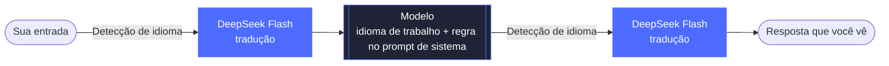

<div align="center">


# dsh-language-bridge

**Atribua a cada modelo um idioma de trabalho** — você escreve no seu idioma, o modelo responde no idioma de trabalho dele e o DeepSeek Flash traduz entre os dois.


[中文](README.md) · [English](README.en.md) · [日本語](README.ja.md) · [Español](README.es.md) · [Français](README.fr.md) · [Deutsch](README.de.md) · [Русский](README.ru.md) · **Português**

[Funcionalidades](#funcionalidades) · [Instalação](#instalação) · [Configurações](#configurações) · [Como funciona](#como-funciona) · [Detecção de idioma](#detecção-de-idioma) · [Limitações conhecidas](#limitações-conhecidas)

</div>

<br>

Plugin da comunidade para o [DeepSeek Harness](https://github.com/deepseek-ai/deepseek-harness). Você escreve no seu idioma, o DeepSeek Flash traduz para o idioma de trabalho do modelo antes de enviar; a resposta do modelo é traduzida de volta para o seu idioma e exibida no mesmo lugar. Qualquer idioma e qualquer modelo podem ser configurados — por exemplo: você usa espanhol, Claude e Gemini ficam em inglês, e um modelo chinês fica em `zh-CN`.

<p align="center">
  
</p>

<p align="center"><sub>Seu idioma está em <code>auto</code> (segue a interface em chinês) e o idioma de trabalho do Claude é inglês. Ao terminar a resposta, ela é trocada automaticamente pela versão em chinês; "Ver original" (查看原文) mostra a resposta do modelo em inglês e "Ver texto enviado" (查看发送内容) mostra o texto em inglês realmente enviado ao modelo. A demonstração foi gravada com a interface em chinês.</sub></p>

## Funcionalidades

- 🧭 **Regras modelo → idioma** — lista ordenada; o id do modelo é comparado com uma expressão regular (sem distinguir maiúsculas de minúsculas) e a primeira regra que corresponder é aplicada; modelos sem correspondência não são alterados.
- 🌐 **Seu idioma** — qualquer código BCP 47 (`es`, `ja`, `zh-CN`…) ou `auto` para seguir o idioma da interface.
- ➡️ **Tradução da entrada** — antes de enviar, traduz o que você escreveu para o idioma de trabalho. Blocos de código, código inline, links e `@caminhos` são preservados como estão.
- ⬅️ **Tradução da resposta** — ao final de cada turno, a resposta é substituída pela tradução; "Ver original / Ver tradução" alterna no mesmo lugar. O conteúdo de raciocínio não é traduzido.
- 📌 **Manter o idioma de trabalho** — para os modelos com ponte, adiciona uma regra ao prompt de sistema pedindo que o modelo pense e responda no idioma de trabalho mesmo ao receber saídas de ferramentas em outros idiomas.
- ⚠️ **Falhas visíveis** — se a tradução falhar, o texto original é enviado normalmente, o turno não é perdido e um aviso aparece abaixo da mensagem.
- 🆓 **Custo zero no mesmo idioma** — quando seu idioma e o idioma de trabalho do modelo são o mesmo (por exemplo, `en-GB` e `en`), não há tradução, nenhum prompt de sistema é adicionado e nenhum custo é gerado.

<p align="center">
  
  <br>
  <sub>Quando a tradução falha, o texto original é enviado normalmente e um aviso aparece abaixo da mensagem.</sub>
</p>

## Instalação

**Requisitos:** DeepSeek Harness (testado com a versão 0.2.1-rc.5 no macOS), com uma chave de API da DeepSeek configurada nele ou com login em uma conta DeepSeek; a tradução é feita pelo DeepSeek Flash.

**Mais rápido:** cole isto em qualquer chat do DSH e deixe o agente instalar:

```text
Install the DeepSeek Harness plugin https://github.com/tonyzdev/dsh-language-bridge into my current profile. If you have the plugin_manager tool, call install_bundle to install and enable it. Otherwise read the profile name ($DSH_PROFILE in bash, $env:DSH_PROFILE in PowerShell) and run `dsh plugin --profile <profile> add github:tonyzdev/dsh-language-bridge`, using the bundled CLI next to app.asar (runtime/cli/bin/dsh, or dsh.cmd on Windows) when the profile is desktop; ask for sandbox approval if needed. Do not edit profile files by hand.
```

Na página "Plugins" do Harness, clique em **Add plugin** e informe o endereço abaixo. Quando a instalação terminar, clique em **Enable now**. Se os botões do plugin não aparecerem, recarregue a página ou reinicie o DeepSeek Harness.

```
https://github.com/tonyzdev/dsh-language-bridge
```

<details>
<summary><b>Instalação ou remoção pela linha de comando</b></summary>

<br>

Primeiro, encerre completamente o DeepSeek Harness e depois execute (este é o caminho do `dsh` no macOS):

```sh
DSH="/Applications/DeepSeek Harness.app/Contents/Resources/runtime/cli/bin/dsh"
"$DSH" plugin --profile desktop add github:tonyzdev/dsh-language-bridge
```

Para trabalhar no código, clone o repositório e instale-o como link; assim, suas alterações se aplicam diretamente a essa cópia:

```sh
git clone https://github.com/tonyzdev/dsh-language-bridge ~/.dsh/local-plugins/dsh-language-bridge
"$DSH" plugin --profile desktop add link:$HOME/.dsh/local-plugins/dsh-language-bridge
```

Para remover, desinstale-o na página "Plugins" ou encerre o Harness e execute:

```sh
"$DSH" plugin --profile desktop remove dsh-language-bridge
```

</details>

## Configurações

Abra "Plugins → Language Bridge"; depois de salvar, as alterações valem a partir do próximo passo, sem precisar reiniciar.

<p align="center">
  
</p>

| Campo | Descrição |
| --- | --- |
| **Your language** | Com `auto`, o navegador informa o idioma da interface ao Host, que o salva; o idioma de interface `zh` é tratado como `zh-CN`. |
| **Model rules** | É possível adicionar, remover e mover para cima ou para baixo. A regex e o código de idioma são validados na hora, no formulário; com erros, não é possível salvar. |
| **Test a model id** | Digite um id de modelo para ver qual regra corresponde e se a tradução é necessária. |

**Regras padrão**

| Regex do id do modelo | Idioma de trabalho |
| --- | :---: |
| `claude` | `en` |
| `gemini` | `en` |
| `(^\|[^a-z0-9])(chat)?gpt($\|[^a-z])` | `en` |

A regra do GPT tem delimitadores: corresponde a `gpt-5`, `openai/gpt-4o`, `chatgpt-4o` e `gpt-oss`, sem capturar por engano ids como `egpt-1` ou `mygpt`.

> [!TIP]
> As configurações ficam em `$DSH_HOME/storages/language-bridge.json` (por padrão, `DSH_HOME` é `~/.dsh`) e têm prioridade sobre o `cordis.patch.yml`. Também é possível definir valores iniciais no `cordis.patch.yml` com `rules` e `userLanguage`, e ajustar o comportamento com `provider` (`auto` / `deepseek-official` / `deepseek-account`), `translateInput` e `translateOutput`.

## Como funciona



<p align="center"><sub>Quando a detecção de idioma conclui que o texto já está no idioma de destino, a tradução é pulada e o texto é enviado ou exibido diretamente.</sub></p>

| Arquivo | Onde roda | Função |
| --- | :---: | --- |
| `index.js` | Host | `agent/pre-step` traduz a entrada; parágrafo do prompt de sistema; endpoints `/api/language-bridge/*` (tradução da resposta, leitura e gravação das configurações, envio do idioma da interface; apenas para o owner) |
| `rules.js` | Compartilhado | Correspondência de regras, validação de códigos de idioma, mesclagem de configurações, texto do prompt de sistema (funções puras) |
| `detect.js` | Compartilhado | Decide se um texto ainda precisa ser traduzido (função pura) |
| `protect.js` | Compartilhado | Protege código e links com marcadores de posição e traduz em blocos |
| `client.js` | Navegador | Substituição e alternância da resposta no mesmo lugar, "Ver texto enviado / Ver original" e aviso de falha nas mensagens do usuário, página de configurações |
| `cordis.patch.yml` | Patch | Insere a linha do serviço translator e a linha deste plugin |

<details>
<summary><b>Detalhes de implementação</b></summary>

<br>

- A tradução usa o `@deepseek-ai/dsh-experimental-translator` que acompanha o dsh, preferindo `deepseek-official` (chave de API) e, em seguida, `deepseek-account`. Os resultados pagos são salvos na sessão; reabri-la não gera nova cobrança.
- O texto original fica em `source.languageBridge` da mensagem; o modelo não o vê, e ele serve apenas para exibição na interface.
- Só as mensagens que você escreve são traduzidas; o contexto injetado pelo sistema e as mensagens de subagentes não são traduzidos.
- Se o modelo de tradução perder os marcadores de posição, passa-se a traduzir apenas o texto entre eles, garantindo que código e links não se percam.
- A página de configurações usa o slot `plugins.bundle.config` da página de detalhes do plugin, em vez do formulário de configuração nativo do Harness: este exige `schemastery`, e plugins locais instalados via `link:` não conseguem resolver esse pacote.

</details>

## Detecção de idioma

`needsTranslation(text, { target, source })` decide se um texto ainda precisa ser traduzido para `target`, verificando, nesta ordem:

1. **Remover o que não é texto corrido** — trechos protegidos e palavras que parecem código (`parseConfig`, `foo_bar`, `src/app.ts`, `v2`, `--flag`, siglas). Se não sobrar nenhuma letra, não traduz.
2. **Comparar os sistemas de escrita** — usa `Intl.Locale` para inferir a escrita do idioma de destino, sem precisar de uma tabela de idiomas. Se outra escrita não latina tiver proporção suficiente, traduz. Quando o destino não usa escrita latina, as letras latinas precisam passar de 60% para contar como idioma estrangeiro, porque é muito comum misturar termos em inglês em textos em chinês, japonês, coreano e russo.
3. **Comparar palavras funcionais** — idiomas que compartilham a mesma escrita (como espanhol e inglês) são distinguidos por tabelas internas de palavras funcionais de 17 idiomas. Se outro idioma predominar claramente, traduz; se o idioma de destino predominar claramente, não traduz.
4. **Ainda indeterminado** — só não traduz quando seu idioma e o destino usam escritas diferentes (um usuário japonês digitando `run tests`); em todos os outros casos, traduz.

> [!IMPORTANT]
> A escolha é **traduzir demais em vez de deixar de traduzir**. Uma tradução a mais custa apenas uma pequena chamada ao DeepSeek Flash e, quando a tradução é igual ao original, o texto não é substituído nem o botão de alternância é exibido; já uma tradução que falta significa que o modelo recebe texto no idioma errado sem que ninguém perceba.

O preço disso:

- frases curtas sem palavras funcionais, como `run tests` digitado por um usuário de espanhol, geram uma chamada a mais;
- pares de idiomas com a mesma escrita e sem tabela de palavras funcionais (por exemplo, usuário de indonésio com modelo em suaíli) geram uma chamada para cada trecho;
- quando há apenas caracteres han, não é possível distinguir chinês de japonês, nem simplificado de tradicional; nesse caso, o texto é tratado como se precisasse de tradução.

## Migrando do claude-zh-bridge

Este plugin substitui o `claude-zh-bridge`, seu antecessor que só suportava chinês. Se você nunca o usou, pule esta seção.

> [!WARNING]
> Não ative os dois plugins ao mesmo tempo, senão tudo será traduzido duas vezes. Primeiro, desinstale o plugin antigo na página "Plugins" ou pela linha de comando:
>
> ```sh
> DSH="/Applications/DeepSeek Harness.app/Contents/Resources/runtime/cli/bin/dsh"
> "$DSH" plugin --profile desktop remove @local/claude-zh-bridge
> ```

As sessões antigas não são afetadas: o texto original que o plugin antigo salvou em `source.claudeZhBridge` continua sendo exibido. A chave do cache de tradução inclui o trecho de texto, o idioma e a rota, e este plugin mantém o mesmo esquema de marcadores de posição e de divisão em blocos (garantido por testes unitários); assim, quando seu idioma é resolvido como `zh-CN`, as traduções que você já pagou nas sessões antigas são reaproveitadas diretamente.

## Desenvolvimento

```sh
node --test test/*.test.js
```

Os testes cobrem ordem e correspondência das regras, detecção de idioma (latino ↔ latino; chinês/japonês/coreano, cirílico, árabe e devanágari nos dois sentidos; mistura com identificadores), trechos protegidos, fallback dos marcadores de posição, além da leitura do campo antigo e da exibição do aviso de falha.

> [!NOTE]
> Depois de alterar `index.js` ou `cordis.patch.yml`, é preciso reiniciar o DeepSeek Harness; se a interface não mudar após alterar `client.js`, reinstale o plugin e recarregue a página.

## Limitações conhecidas

> [!CAUTION]
> **A regra no prompt de sistema só aumenta a probabilidade; não é uma garantia.** Nos testes, vimos modelos ignorá-la: quando a tradução falhou e o Claude recebeu japonês diretamente, ele respondeu em japonês; quando a regra foi adicionada no meio de uma sessão, o Gemini Flash Lite, que já tinha histórico em espanhol, continuou respondendo em espanhol. Quando a resposta já está no seu idioma, ela não é traduzida de novo.

- O conteúdo de raciocínio visível depende da rota do modelo e pode ser apenas um resumo; quando não está visível, não há como confirmar em que idioma o modelo pensou.
- Só blocos de código, código inline, links e `@caminhos` são protegidos. Comandos e citações sem crases também são traduzidos, como a string dentro de `printf "..."`. Coloque entre crases o que não deve ser traduzido. Um trecho em chinês no meio de uma frase em inglês também é traduzido.
- O log da sessão e a entrada do modelo contêm a tradução (o plugin só consegue reescrever a mensagem antes de ela ser gravada); o original serve apenas para exibição na interface.
- A resposta só é trocada pela tradução ao final do turno; durante a geração, é exibido o texto original do modelo.
- Com `auto`, não é possível saber se os idiomas coincidem antes de o navegador informar o idioma da interface; nesse intervalo, só a detecção de idioma é usada.
- Cada trecho de texto sem cache é uma requisição paga ao DeepSeek Flash.
- Os botões e os textos de aviso estão disponíveis em oito idiomas: chinês, inglês, japonês, espanhol, francês, alemão, russo e português; a página de configurações só existe em chinês e inglês, e os demais idiomas veem a versão em inglês.
- Se ativado junto com o bundle oficial de tradução do raciocínio (「推理翻译」), cada um monta sua própria instância do serviço translator, o que pode causar conflito.
- O plugin assume a renderização das mensagens do usuário; atualizações do Harness que mudem a estrutura do Chat podem exigir ajustes.
