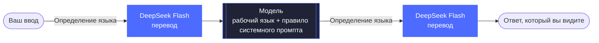

<div align="center">


# dsh-language-bridge

**Назначьте каждой модели рабочий язык** — вы пишете на своём языке, модель отвечает на своём рабочем языке, а DeepSeek Flash переводит между ними.


[中文](README.md) · [English](README.en.md) · [日本語](README.ja.md) · [Español](README.es.md) · [Français](README.fr.md) · [Deutsch](README.de.md) · **Русский** · [Português](README.pt.md)

[Возможности](#возможности) · [Установка](#установка) · [Настройки](#настройки) · [Как это работает](#как-это-работает) · [Определение языка](#определение-языка) · [Известные ограничения](#известные-ограничения)

</div>

<br>

Плагин сообщества для [DeepSeek Harness](https://github.com/deepseek-ai/deepseek-harness). Вы пишете на своём языке, DeepSeek Flash переводит текст на рабочий язык модели и отправляет его; ответ модели переводится обратно на ваш язык и отображается на том же месте. Настроить можно любой язык и любую модель — например, вы пишете по-испански, для Claude и Gemini задан английский, а для какой-нибудь китайской модели — `zh-CN`.

<p align="center">
  
</p>

<p align="center"><sub>Демонстрация записана с китайским интерфейсом. Ваш язык — <code>auto</code> (следует за китайским интерфейсом), рабочий язык Claude — английский. По окончании ответа текст автоматически заменяется китайским; «Показать оригинал» (查看原文) выводит английский ответ модели, а «Показать отправленный текст» (查看发送内容) — английский текст, который модель получила на самом деле.</sub></p>

## Возможности

- 🧭 **Правила «модель → язык»** — упорядоченный список, id модели сопоставляется с регулярным выражением (без учёта регистра), срабатывает первое подходящее правило; модели без совпадений работают как обычно.
- 🌐 **Ваш язык** — любой код BCP 47 (`es`, `ja`, `zh-CN`…) или `auto`, чтобы следовать за языком интерфейса.
- ➡️ **Перевод ввода** — перед отправкой написанный вами текст переводится на рабочий язык. Блоки кода, встроенный код, ссылки и `@пути` сохраняются без изменений.
- ⬅️ **Перевод ответов** — после каждого хода ответ заменяется переводом, «Показать оригинал / Показать перевод» переключают отображение на месте. Рассуждения модели не переводятся.
- 📌 **Удержание рабочего языка** — для моделей, работающих через мост, в системный промпт добавляется правило: думать и отвечать на рабочем языке, даже если вывод инструментов приходит на другом.
- ⚠️ **Заметные сбои** — при ошибке перевода исходный текст отправляется как есть, ход не теряется, а под сообщением появляется предупреждение.
- 🆓 **Без затрат при совпадении языков** — если ваш язык и рабочий язык модели совпадают (например, `en-GB` и `en`), перевода и добавления в системный промпт не происходит, а расходов нет.

<p align="center">
  
  <br>
  <sub>При сбое перевода исходный текст отправляется как обычно, а под сообщением появляется предупреждение.</sub>
</p>

## Установка

**Требования:** DeepSeek Harness (проверено на версии 0.2.1-rc.5 для macOS), в котором настроен API-ключ DeepSeek или выполнен вход в аккаунт DeepSeek; перевод выполняет DeepSeek Flash.

**Быстрее всего:** вставьте это в любой чат DSH, и агент установит плагин сам:

```text
Install the DeepSeek Harness plugin https://github.com/tonyzdev/dsh-language-bridge into my current profile: run `dsh plugin --profile "$DSH_PROFILE" add github:tonyzdev/dsh-language-bridge` (in the desktop app, use the bundled dsh at runtime/cli/bin/dsh next to app.asar). Do not edit profile files by hand.
```

На странице «Plugins» в Harness нажмите **Add plugin** и введите указанный ниже адрес. После установки нажмите **Enable now**. Если кнопки плагина не появились, обновите страницу или перезапустите DeepSeek Harness.

```
https://github.com/tonyzdev/dsh-language-bridge
```

<details>
<summary><b>Установка и удаление из командной строки</b></summary>

<br>

Сначала полностью закройте DeepSeek Harness, затем выполните (это путь к `dsh` в macOS):

```sh
DSH="/Applications/DeepSeek Harness.app/Contents/Resources/runtime/cli/bin/dsh"
"$DSH" plugin --profile desktop add github:tonyzdev/dsh-language-bridge
```

Чтобы работать с кодом, клонируйте репозиторий и установите его как ссылку — тогда ваши правки будут применяться непосредственно к этой копии:

```sh
git clone https://github.com/tonyzdev/dsh-language-bridge ~/.dsh/local-plugins/dsh-language-bridge
"$DSH" plugin --profile desktop add link:$HOME/.dsh/local-plugins/dsh-language-bridge
```

Удалить плагин можно на странице «Plugins» или командой ниже, предварительно закрыв Harness:

```sh
"$DSH" plugin --profile desktop remove dsh-language-bridge
```

</details>

## Настройки

Откройте «Plugins → Language Bridge». Сохранённые настройки действуют со следующего шага, перезапуск не нужен.

<p align="center">
  
</p>

| Поле | Описание |
| --- | --- |
| **Your language** | При значении `auto` браузер сообщает язык интерфейса хосту, и тот его сохраняет; язык интерфейса `zh` обрабатывается как `zh-CN`. |
| **Model rules** | Правила можно добавлять, удалять и перемещать вверх и вниз. Регулярные выражения и коды языков проверяются прямо в форме; при наличии ошибок сохранить настройки нельзя. |
| **Test a model id** | Введите id модели, чтобы увидеть, какое правило сработает и нужен ли перевод. |

**Правила по умолчанию**

| Регулярное выражение для id модели | Рабочий язык |
| --- | :---: |
| `claude` | `en` |
| `gemini` | `en` |
| `(^\|[^a-z0-9])(chat)?gpt($\|[^a-z])` | `en` |

Правило для GPT учитывает границы: оно совпадает с `gpt-5`, `openai/gpt-4o`, `chatgpt-4o`, `gpt-oss`, но не срабатывает ошибочно на id вроде `egpt-1` и `mygpt`.

> [!TIP]
> Настройки хранятся в `$DSH_HOME/storages/language-bridge.json` (по умолчанию `DSH_HOME` — это `~/.dsh`) и имеют приоритет над `cordis.patch.yml`. В `cordis.patch.yml` также можно задать начальные значения через `rules` и `userLanguage`, а поведение настроить через `provider` (`auto` / `deepseek-official` / `deepseek-account`), `translateInput` и `translateOutput`.

## Как это работает



<p align="center"><sub>Если определение языка показывает, что текст уже на целевом языке, перевод пропускается и текст сразу отправляется или отображается.</sub></p>

| Файл | Где работает | Назначение |
| --- | :---: | --- |
| `index.js` | Хост | `agent/pre-step` переводит ввод; раздел системного промпта; API `/api/language-bridge/*` (перевод ответов, чтение и запись настроек, передача языка интерфейса, только для владельца) |
| `rules.js` | Общий | Сопоставление правил, проверка кодов языков, объединение настроек, текст системного промпта (чистые функции) |
| `detect.js` | Общий | Определяет, нужен ли тексту перевод (чистые функции) |
| `protect.js` | Общий | Защищает код и ссылки плейсхолдерами, переводит текст частями |
| `client.js` | Браузер | Замена ответа на месте и переключение, «Показать отправленный текст / Показать оригинал» и предупреждение о сбое у сообщений пользователя, страница настроек |
| `cordis.patch.yml` | Патч | Вставляет строку сервиса translator и строку этого плагина |

<details>
<summary><b>Подробности реализации</b></summary>

<br>

- Перевод выполняется через встроенный в dsh пакет `@deepseek-ai/dsh-experimental-translator`, в первую очередь через `deepseek-official` (API-ключ), затем через `deepseek-account`. Оплаченные результаты хранятся в сеансе, поэтому при повторном открытии плата не взимается снова.
- Исходный текст хранится в поле сообщения `source.languageBridge`; модель его не видит, он используется только для отображения в интерфейсе.
- Переводятся только написанные вами сообщения; контекст, добавленный системой, и сообщения субагентов не переводятся.
- Если модель-переводчик теряет плейсхолдеры, переводится только текст между ними, чтобы код и ссылки не пропали.
- Страница настроек использует слот `plugins.bundle.config` страницы сведений о плагине, а не встроенную форму конфигурации Harness: той нужен пакет `schemastery`, который локальные плагины, установленные через `link:`, найти не могут.

</details>

## Определение языка

`needsTranslation(text, { target, source })` определяет, нужно ли ещё переводить текст на `target`, проверяя по порядку:

1. **Удаление всего, что не является основным текстом** — защищённых фрагментов и слов, похожих на код (`parseConfig`, `foo_bar`, `src/app.ts`, `v2`, `--flag`, аббревиатуры). Если букв не осталось, перевод не выполняется.
2. **Сравнение письменностей** — письменность целевого языка вычисляется через `Intl.Locale`, таблица языков не нужна. Если доля другой нелатинской письменности достаточно высока, текст переводится. Если целевой язык использует не латиницу, текст считается иноязычным, только когда латинские буквы составляют более 60 %, поскольку английские термины в китайских, японских, корейских и русских текстах встречаются часто.
3. **Сравнение служебных слов** — языки с одной письменностью (например, испанский и английский) различаются по встроенным спискам служебных слов для 17 языков. Если явно преобладает другой язык, текст переводится; если явно преобладает целевой, не переводится.
4. **Если определить всё ещё не удалось** — текст не переводится, только когда ваш язык и целевой используют разные письменности (пользователь с японским языком вводит `run tests`); во всех остальных случаях он переводится.

> [!IMPORTANT]
> Принцип такой: **лучше перевести лишний раз, чем пропустить перевод**. Лишний перевод — это лишь небольшой расход на DeepSeek Flash, причём если перевод совпадает с оригиналом, замены не происходит и кнопка переключения не показывается. Пропущенный же перевод означает, что модель получает текст не на том языке, и никто этого не замечает.

Цена такого выбора:

- короткая фраза без служебных слов вроде `run tests` от пользователя с испанским языком приведёт к одному лишнему вызову;
- для пар языков с одной письменностью без списков служебных слов (например, пользователь с индонезийским языком и модель с суахили) вызов будет выполняться для каждого фрагмента;
- если текст состоит только из иероглифов, китайский и японский, а также упрощённое и традиционное письмо не различаются, и в этом случае текст считается требующим перевода.

## Переход с claude-zh-bridge

Этот плагин заменяет `claude-zh-bridge` — своего предшественника, который поддерживал только китайский язык. Если вы им не пользовались, пропустите этот раздел.

> [!WARNING]
> Не включайте оба плагина одновременно, иначе всё будет переводиться дважды. Сначала удалите старый плагин на странице «Plugins» или из командной строки:
>
> ```sh
> DSH="/Applications/DeepSeek Harness.app/Contents/Resources/runtime/cli/bin/dsh"
> "$DSH" plugin --profile desktop remove @local/claude-zh-bridge
> ```

Старые сеансы это не затронет: исходный текст, сохранённый старым плагином в `source.claudeZhBridge`, по-прежнему отображается. Ключ кэша перевода включает фрагмент текста, язык и маршрут, а этот плагин сохраняет те же плейсхолдеры и то же разбиение на части (это гарантируют модульные тесты), поэтому, когда ваш язык разрешается в `zh-CN`, уже оплаченные в старых сеансах переводы просто используются повторно.

## Разработка

```sh
node --test test/*.test.js
```

Тесты покрывают порядок и сопоставление правил, определение языка (латиница↔латиница; китайский, японский, корейский, кириллица, арабское письмо и деванагари в обе стороны; текст вперемешку с идентификаторами), защищённые фрагменты, откат при потере плейсхолдеров, а также чтение старого поля и отображение предупреждения о сбое.

> [!NOTE]
> После изменения `index.js` или `cordis.patch.yml` нужно перезапустить DeepSeek Harness; если после изменения `client.js` интерфейс не изменился, переустановите плагин и обновите страницу.

## Известные ограничения

> [!CAUTION]
> **Правило в системном промпте лишь повышает вероятность, но не даёт гарантии.** В тестах встречались случаи, когда модели его не соблюдали: при сбое перевода Claude, получив текст на японском, отвечал на японском; когда правило добавили посреди сеанса, Gemini Flash Lite с уже имеющейся историей на испанском продолжал отвечать по-испански. Если ответ уже на вашем языке, повторный перевод не выполняется.

- Доступные для просмотра рассуждения зависят от маршрута модели и могут быть лишь кратким изложением; если их не видно, узнать, на каком языке думает модель, невозможно.
- Защищены только блоки кода, встроенный код, ссылки и `@пути`. Команды и цитаты без обратных кавычек тоже переводятся, например строка внутри `printf "..."`. Заключайте в обратные кавычки всё, что не должно переводиться. Фрагмент на китайском внутри английского предложения тоже будет переведён.
- В журнале сеанса и во входных данных модели находится перевод (плагин может переписать сообщение только до его записи); исходный текст используется только для отображения в интерфейсе.
- Ответ заменяется переводом только по окончании хода; во время генерации показывается исходный текст модели.
- Пока браузер не сообщит язык интерфейса, при значении `auto` нельзя определить, совпадают ли языки; в это время работает только определение языка.
- Каждый некэшированный фрагмент текста — это один платный запрос к DeepSeek Flash.
- Текст кнопок и предупреждений доступен на восьми языках: китайском, английском, японском, испанском, французском, немецком, русском и португальском; страница настроек есть только на китайском и английском, для остальных языков она показывается на английском.
- При одновременном включении с официальным бандлом перевода рассуждений («推理翻译») каждый из них подключает собственный экземпляр сервиса translator, что может привести к конфликту.
- Плагин берёт на себя отрисовку сообщений пользователя, поэтому после обновления Harness с изменением структуры Chat могут потребоваться правки.
